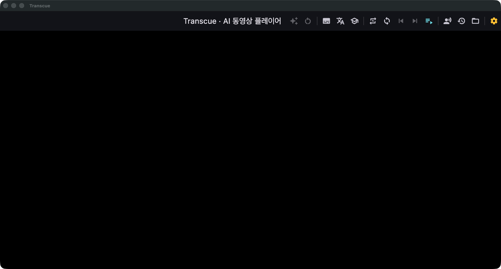
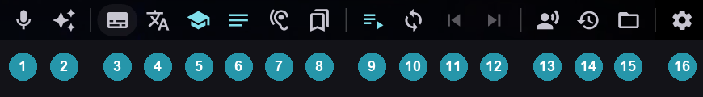
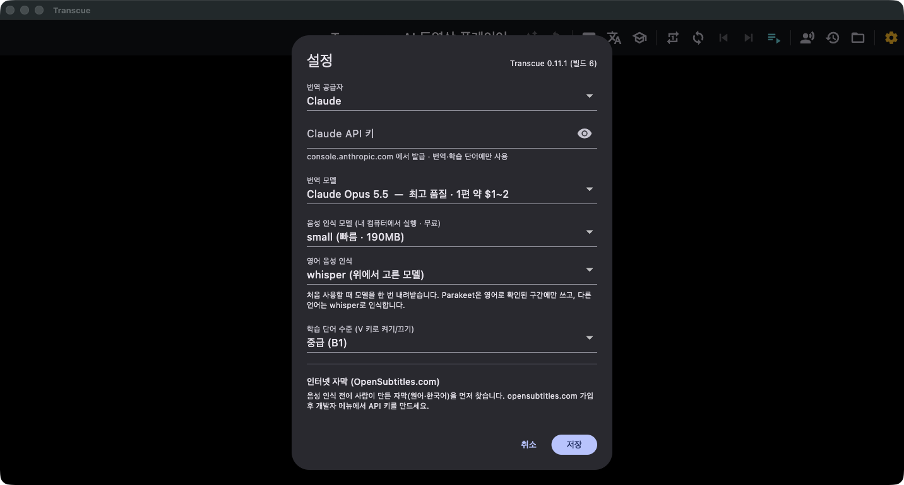
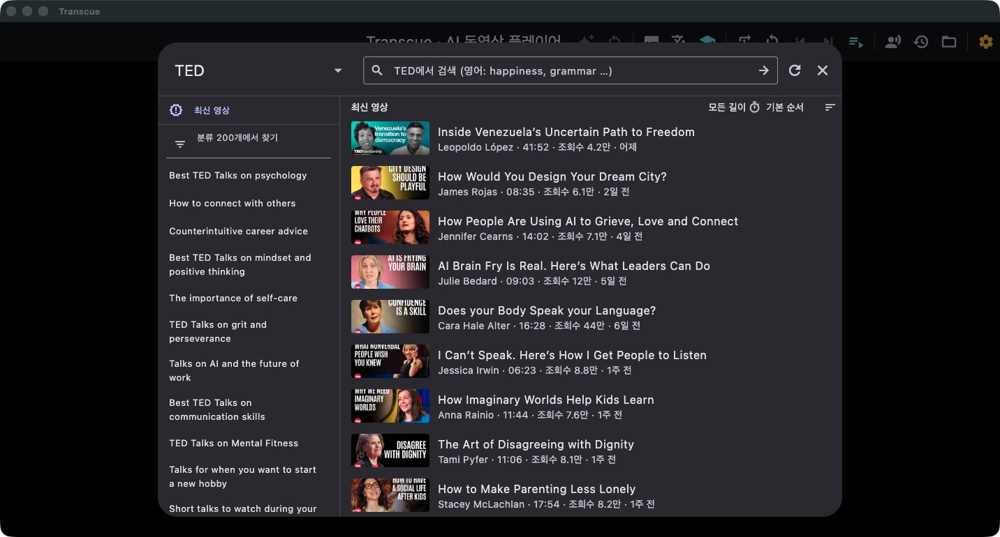
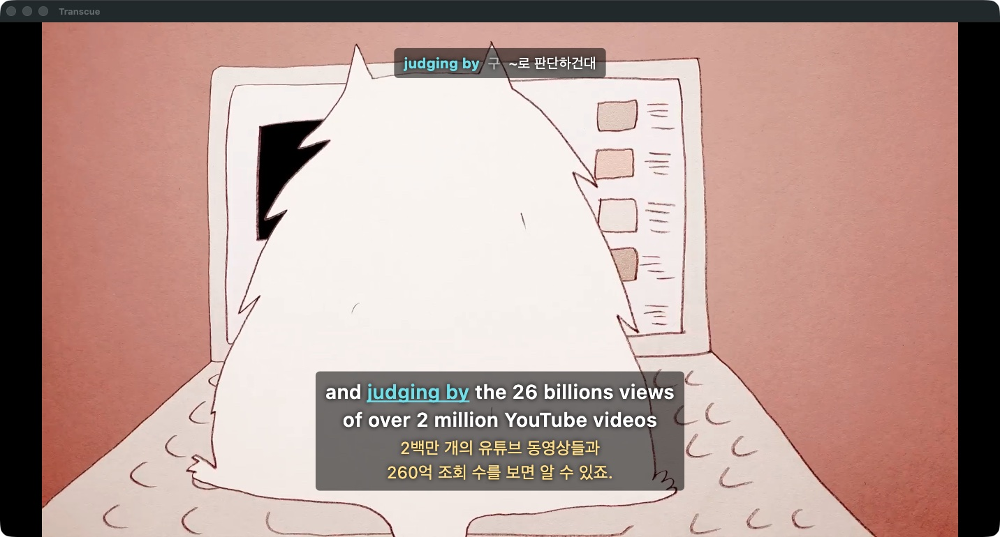

# Transcue 사용 설명서

Transcue는 영상을 열면 **원어 자막과 한국어 자막을 함께** 보여 주는 동영상 플레이어입니다.
자막이 없는 영상도 AI가 음성을 받아 적어 자막을 만들어 줍니다.

처음 쓰는 분은 아래 순서대로 따라 하면 됩니다.

1. [설치하기](#1-설치하기)
2. [화면 둘러보기](#2-화면-둘러보기)
3. [번역 설정하기 (처음 한 번)](#3-번역-설정하기-처음-한-번)
4. [영상 열기](#4-영상-열기)
5. [자막 보며 공부하기](#5-자막-보며-공부하기)
6. [키보드·마우스 조작](#6-키보드마우스-조작)
7. [자주 묻는 질문](#7-자주-묻는-질문)

---

## 1. 설치하기

| 기기 | 방법 |
|---|---|
| **Mac** | 터미널을 열고 아래 한 줄을 붙여 넣은 뒤 Enter |
| **Windows** | [Releases](https://github.com/planet6897/transcue/releases)에서 `windows-x64.zip`을 받아 압축을 풀고 `transcue.exe` 실행 |
| **Linux** | `linux-x64.tar.gz`를 받아 풀고 `transcue` 실행 |
| **Android·Android TV** | `android.apk`를 받아 설치 |

Mac 설치 명령:

```bash
curl -fsSL https://raw.githubusercontent.com/planet6897/transcue/main/scripts/install-macos.sh | bash
```

> **Windows에서 "Windows의 PC 보호" 창이 뜨면** `추가 정보` → `실행`을 누르세요.

PC에서 자막 만들기(음성 인식)와 YouTube 재생을 쓰려면 ffmpeg, whisper.cpp, yt-dlp가 필요합니다.
설치 명령은 [README의 개발 환경](../README.md#개발-환경)에 있습니다.

---

## 2. 화면 둘러보기

앱을 켜면 위쪽에 메뉴가 보입니다.



메뉴 버튼은 왼쪽부터 이렇게 생겼습니다.



| 번호 | 이름 | 하는 일 |
|:---:|---|---|
| 1 | 자막 자동 생성 | YouTube·내장 자막 대신 음성 인식으로 자막을 만든다 |
| 2 | AI 번역 | 원문은 그대로 두고 번역만 AI로 새로 한다 |
| 3 | 원문 자막 | 원어 자막을 켜고 끈다 |
| 4 | 번역 자막 | 한국어 자막을 켜고 끈다 |
| 5 | 학습 단어 | 자막 속 어려운 단어의 뜻을 보여 준다 |
| 6 | 재생 모드 | 영상이 끝났을 때: **연속 재생**(다음 영상) → **반복 재생**(지금 영상을 계속) → **한 번 재생**(멈춤) 차례로 바뀐다 |
| 7 | 문장·구간 반복 | 지금 문장(한·두·세 문장) 또는 직접 정한 A–B 구간을 정한 횟수만큼 되풀이한다 |
| 8 | 이전 영상 | 목록의 앞 영상으로 |
| 9 | 다음 영상 | 목록의 다음 영상으로 |
| 10 | 영어 강연·학습 채널 | TED·BBC·VOA 영상을 골라 본다 |
| 11 | 최근 재생목록 | 전에 본 영상을 다시 연다 |
| 12 | 동영상 열기 | 내 컴퓨터의 동영상 파일을 연다 |
| 13 | 설정 | 번역 API 키 등을 넣는다 |

연속 재생의 "다음 영상"은 YouTube는 채널 목록(TED 등)의 다음 영상, 내 컴퓨터의 동영상은 같은 폴더의 다음 파일입니다.
링크로 연 YouTube 영상은 이어서 틀 목록이 없어 끝나면 멈춥니다.

- 영상을 보는 동안에는 메뉴가 숨겨집니다. **마우스를 움직이면** 다시 나타납니다.
- 버튼 위에 마우스를 올리면 이름이 뜹니다.
- 설정 버튼(13)이 **노란색**이면 아직 번역 설정을 하지 않았다는 뜻입니다.

---

## 3. 번역 설정하기 (처음 한 번)

한국어 자막은 AI 번역 서비스가 만듭니다. 그래서 처음에 **API 키**를 한 번 넣어야 합니다.
넣지 않아도 원어 자막은 나오지만, 한국어 자막과 학습 단어는 나오지 않습니다.

1. 메뉴 오른쪽 끝의 **설정**(톱니바퀴)을 누릅니다.
2. **번역 공급자**를 고릅니다 (Claude, OpenAI, Gemini 중 하나).
3. 고른 서비스의 사이트에서 API 키를 발급받아 **API 키** 칸에 붙여 넣습니다.
4. **저장**을 누릅니다.



| 공급자 | API 키 발급 사이트 |
|---|---|
| Claude | console.anthropic.com |
| OpenAI | platform.openai.com |
| Gemini | aistudio.google.com |

> **비용 안내:** 번역은 쓴 만큼 요금이 나옵니다. 설정 창의 **번역 모델**에 모델마다 예상 비용이 표시됩니다.
> 처음에는 가장 품질이 좋은(가장 비싼) 모델이 골라져 있으니, 비용을 아끼려면 `가장 저렴`이라고 적힌 모델로 바꾸세요.
> 가장 저렴한 모델은 영상 한 편에 수십 원 수준입니다.
> 음성 인식(자막 만들기)은 내 컴퓨터에서 돌아가므로 무료입니다.

나머지 항목은 그대로 두어도 됩니다.

- **음성 인식 모델**: 자막이 없는 영상에서 음성을 받아 적는 모델. 처음 쓸 때 한 번 내려받습니다.
- **학습 단어 수준**: 내 영어 수준에 맞춰 어떤 단어를 보여 줄지 정합니다.
- **인터넷 자막 (OpenSubtitles)**: 영화·드라마 파일의 자막을 인터넷에서 먼저 찾아 줍니다 (선택).

---

## 4. 영상 열기

### 방법 1. YouTube 링크 끌어다 놓기 (PC)

브라우저에서 **YouTube 링크를 마우스로 끌어서 Transcue 창 위에 놓으면** 바로 재생됩니다.

1. 브라우저에서 보고 싶은 YouTube 영상을 엽니다.
2. 주소창의 주소(또는 영상 썸네일·제목)를 마우스로 누른 채 Transcue 창으로 끌고 갑니다.
3. 창 위에서 마우스를 놓습니다.

다른 영상을 보는 중에 놓아도 그 영상으로 바뀝니다. macOS·Windows·Linux에서 됩니다.

### 방법 2. 영어 강연·학습 채널에서 고르기

메뉴의 **영어 강연·학습 채널** 버튼(10)을 누르면 TED·BBC·VOA 영상 목록이 나옵니다.



- 왼쪽 위에서 **채널**을 바꿉니다.
- 위쪽 **검색창**에 영어로 주제를 넣어 찾습니다 (예: happiness, grammar).
- 왼쪽 **분류**를 누르면 주제별 영상이 나옵니다.
- 오른쪽 목록에서 영상을 누르면 재생됩니다.

### 방법 3. 내 컴퓨터의 동영상 파일

메뉴의 **동영상 열기** 버튼(12)으로 파일을 고르거나, 파일을 Transcue 창 위에 끌어다 놓습니다.

### 방법 4. 전에 본 영상 다시 열기

메뉴의 **최근 재생목록** 버튼(11)을 누르면 전에 본 영상이 나옵니다. 보던 곳부터 이어서 재생됩니다.

---

## 5. 자막 보며 공부하기

영상이 열리면 아래쪽에 **원어 자막(흰색)** 과 **한국어 자막(노란색)** 이 함께 나옵니다.



*(화면 예시: TED-Ed, "Why do cats act so weird?")*

- **밑줄 친 하늘색 단어**는 학습 단어입니다. 화면 위쪽에 그 단어의 품사와 **이 문장에서의 뜻**이 나옵니다.
  `V` 키나 메뉴의 학습 단어 버튼(5)으로 켜고 끕니다.
- 자막이 없는 영상은 AI가 음성을 받아 적어 자막을 만듭니다. 재생하는 곳부터 먼저 만들기 때문에
  처음 몇 초는 자막이 늦게 나올 수 있습니다.
- 한 번 만든 자막과 번역은 저장됩니다. 같은 영상을 다시 열면 바로 나오고 비용도 다시 들지 않습니다.

### 문장 단위로 듣기

- `←` `→` 키로 **이전 문장 / 다음 문장**으로 바로 갑니다.
- `L` 키나 문장·구간 반복 버튼(7)으로 **지금 문장을 되풀이**해서 듣습니다.
  버튼 메뉴에서 반복할 크기(한 문장·두 문장·세 문장·직접 지정)와 횟수(계속·2번·3번·5번)를 고릅니다.
- **구간 반복**: 반복하고 싶은 곳의 시작에서 `A`, 끝에서 `B` 키를 누르면 그 구간을 되풀이합니다.
  정한 횟수를 다 들으면 반복을 끝내고 이어서 재생합니다. 메뉴의 '직접 지정'을 고르면 마지막에 정한 구간을 다시 반복합니다.

### 자막이 소리와 안 맞을 때

- YouTube 자막과 인터넷 자막은 재생을 시작할 때 **자동으로 맞춥니다.** 잠시 뒤 위쪽 상태 줄에
  `싱크 자동 보정 +18.4초`처럼 표시됩니다.
- 그래도 안 맞으면 `[` 키(자막을 0.2초 빠르게)와 `]` 키(0.2초 늦게)로 직접 맞춥니다.

### 자막이나 번역이 이상할 때

- 번역만 다시: **AI 번역** 버튼(2). YouTube 한국어 자막 대신 AI 번역을 쓰고 싶을 때도 누릅니다
- 자막부터 다시: **자막 자동 생성** 버튼(1) → `자막 생성`. 이미 음성 인식 자막이면 `원래 자막으로 되돌리기`도 고를 수 있습니다

다시 만들면 번역 비용이 다시 듭니다.

---

## 6. 키보드·마우스 조작

### 키보드

| 키 | 동작 |
|---|---|
| `Space` 또는 `Enter` | 재생 / 일시정지 |
| `←` `→` | 이전 문장 / 다음 문장 (자막이 없으면 5초 이동) |
| `↑` `↓` | 소리 크게 / 작게 |
| `L` | 문장·구간 반복 켜기 / 끄기 |
| `A` `B` | 구간 반복의 시작 / 끝 정하기 (B를 누르면 반복 시작) |
| `V` | 학습 단어 켜기 / 끄기 |
| `R` | 재생 모드 바꾸기 (연속 → 반복 → 한 번) |
| `N` `P` | 다음 영상 / 이전 영상 |
| `[` `]` | 자막을 0.2초 빠르게 / 늦게 |
| `Home` | 처음부터 |
| `F` | 전체 화면 |
| `Esc` | 전체 화면 나가기 |

### 마우스

| 동작 | 결과 |
|---|---|
| 영상 클릭 | 재생 / 일시정지 |
| 영상 더블 클릭 | 전체 화면 |
| 영상 **오른쪽 절반**에서 휠 | 소리 조절 |
| 영상 **왼쪽 절반**에서 휠 | 화면 밝기 조절 |

### Android TV 리모컨

- **가운데 버튼**: 재생 / 일시정지
- **← →**: 이전 문장 / 다음 문장
- **↑ ↓ 또는 뒤로 버튼**: 메뉴 열기
- 메뉴가 떠 있을 때 **뒤로 버튼**을 한 번 더 누르면 앱이 닫힙니다.

---

## 7. 자주 묻는 질문

**한국어 자막이 안 나와요.**
설정 버튼이 노란색인지 보세요. 노란색이면 [번역 설정](#3-번역-설정하기-처음-한-번)이 필요합니다.
키를 넣었는데도 안 나오면 위쪽 상태 줄에 뜨는 안내(예: API 키 오류)를 확인하세요.

**Mac에서 앱이 "손상되었다"거나 열 수 없다고 나와요.**
브라우저로 내려받으면 macOS가 막습니다. [설치하기](#1-설치하기)의 터미널 명령으로 설치하거나,
터미널에서 `xattr -cr /Applications/Transcue.app`을 실행하세요.

**자막이 나오기까지 오래 걸려요.**
자막이 없는 영상은 내 컴퓨터가 직접 음성을 받아 적습니다. 컴퓨터 성능에 따라 시간이 걸립니다.
설정의 음성 인식 모델에서 `small (빠름)`은 빠르고, `large-v3-turbo (정확)`은 더 정확하지만 느립니다.

**YouTube 영상이 안 열려요.**
PC에서는 yt-dlp가 설치돼 있어야 합니다. 오래된 yt-dlp는 YouTube가 바뀌면 동작하지 않으니 최신 버전으로 올려 보세요.
